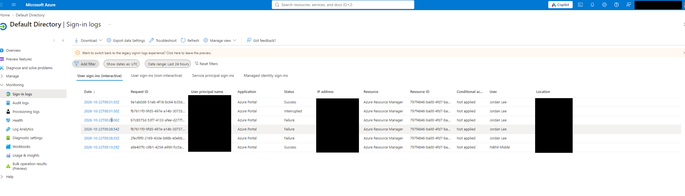
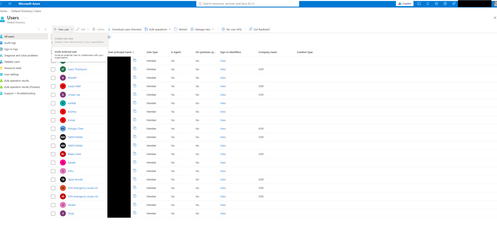
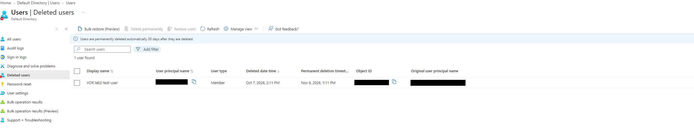

# Microsoft Entra ID: Least Privilege and Admin Roles

## Overview
Hands-on IAM lab for fictional company VDR.
Assigned administrator roles based on job responsibilities
and tested permitted and restricted actions.

## Role Assignments
| User | Role | Responsibility |
|---|---|---|
| Casey Patel | Password Administrator | Reset employee passwords |
| Taylor Brooks | User Administrator | Manage employee accounts |
| Jordan Lee | Reports Reader | Read audit and sign-in reports |

## Tests Completed
- Casey reset Venkat’s password successfully.
- User creation and audit-log access were blocked for Casey.
- Taylor created and deleted a temporary test user.
- Confirmed the test user appeared in Deleted users.
- Jordan accessed audit logs and sign-in logs.
- User creation was disabled for Jordan.
- Reviewed audit records for role assignments.

## Emergency Access
Created two emergency-access accounts and assigned
Global Administrator to both.

Both accounts displayed “No usable methods” on their
Authentication methods pages.

Status: incomplete and not ready for emergency use.
Phishing-resistant authentication, recovery testing,
and monitoring remain pending.

## Documentation
- [Role assignment rationale](./role-assignment-rationale)
- [Ticket exercise](./ticket-exercise)
- [Emergency access notes](./break-glass)

## Key Lesson
Least privilege means assigning only the permissions
required for a person’s responsibilities.

## Screenshot Evidence

### Reports Reader — Sign-in Logs
Jordan Lee accessed the sign-in logs during role testing.
Email addresses, IP addresses, and locations are redacted.

### Reports Reader — User Creation Restricted
While signed in as Jordan Lee, the Create new user option was disabled.

### User Administrator — Deleted Test Account
The temporary VDR lab2-test-user account appears in Deleted users after the user-management test. This screenshot documents the deleted account state; the deletion audit record identifies the actor. User principal names and the object ID are redacted.

